<div align="center">

# Murmur

**Full stack chat app, built in Kotlin and felt natively on Android and iOS.**

A Kotlin Multiplatform chat app with a Ktor server, shared client and view-model logic, and fully native UIs.

<p>
  <a href="https://kotlinlang.org/docs/multiplatform.html"></a>
  <a href="https://ktor.io"></a>
  <a href="https://developer.android.com/compose"></a>
  <a href="https://developer.apple.com/xcode/swiftui/"></a>
</p>

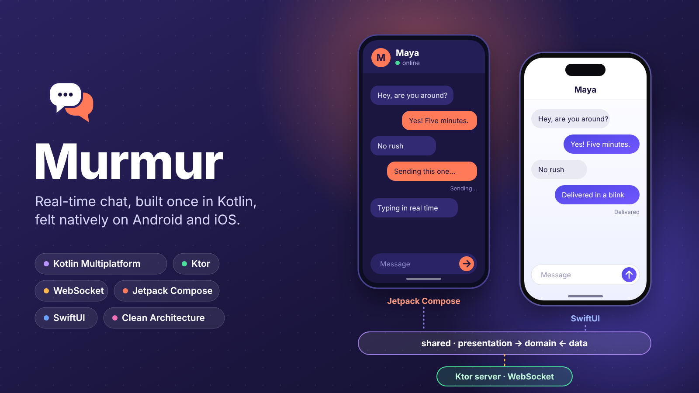

</div>

---

## Overview

Murmur is a one-to-one chat app that shares everything that is not pixels. Networking, the chat state machine, session
handling and even the **view models** are written once in Kotlin (`shared`). Each platform keeps a thin native wrapper and
its own UI, so Android feels like Android and iOS feels like iOS.

- **[Kotlin Multiplatform](https://kotlinlang.org/docs/multiplatform.html)** for the shared logic
- **[Ktor](https://ktor.io)** for the server (HTTP + WebSocket) and the client
- **[Jetpack Compose](https://developer.android.com/compose)** for the Android UI
- **[SwiftUI](https://developer.apple.com/xcode/swiftui/)** for the iOS UI

### Demo

https://github.com/user-attachments/assets/3023a30b-0569-4f9b-9f33-5f720fc9b7bf


### Features

- Register, log in, and stay logged in (the saved session is restored on launch)
- Contact list with live online / offline presence
- One-to-one chat over a single WebSocket, with history paging
- Optimistic sending: messages appear instantly, are confirmed by the server, and can be retried or deleted if they fail
- Safe retries: sending is idempotent, so a retry never creates a duplicate
- Automatic reconnect that resyncs anything missed while offline
---

## Architectural Approach

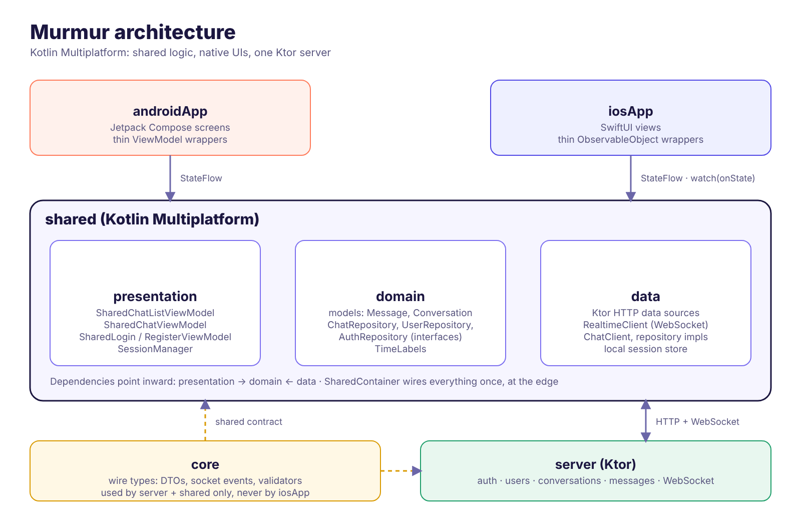

The app is split so that **logic is shared and UI is native**, with dependencies always pointing inward.

| Module | Responsibility |
|---|---|
| `core` | The contract between client and server: DTOs, socket events, validators. Used by `server` and `shared` only, never by the iOS app. |
| `shared` | Data layer (Ktor HTTP + WebSocket, session store), domain layer (models, repository interfaces) and the shared view models. |
| `server` | Ktor server: auth, users, conversations, messages and the WebSocket. |
| `androidApp` | Compose screens, type-safe navigation and thin `ViewModel` wrappers. |
| `iosApp` | SwiftUI views and thin `ObservableObject` wrappers. |

**Clean architecture inside `shared`:**

- **Domain:** plain models and repository interfaces (`ChatRepository`, `UserRepository`, `AuthRepository`).
- **Data:** HTTP data sources, the realtime client and the repository implementations.
- **Presentation:** shared view models (`SharedChatListViewModel`, `SharedChatViewModel`, `SharedLoginViewModel`,
  `SharedRegisterViewModel`) and `SessionManager`. They expose one `StateFlow` of UI state and depend on domain interfaces only.
- **`SharedContainer`** is the only place that wires objects together, at the edge of the app.

**How each platform uses it:**

- **Android:** a small `androidx.lifecycle.ViewModel` holds the shared view model and calls `clear()` in `onCleared()`.
- **iOS:** a small `ObservableObject` follows the shared view model through one generic `KotlinObserver`
  (`watch(onState:)`) and calls `clear()` in `deinit`. Views are split into a wrapper that owns the view model and a
  stateless content view, so previews only need a state.

**How chat works:**

- **One socket per user** carries typed JSON events (`message_received`, `presence_changed`, `send_message`,
  `chat_error`) next to a normal HTTP API for history, users and conversations.
- **Sending:** the client creates the message id and shows the message as *sending*. The server's echo is the
  acknowledgement and turns it into *sent*. If the socket is down, the server refuses it, or 10 seconds pass with no
  answer, it becomes *failed*. A retry re-sends the same id, so the server simply confirms it if the first attempt arrived.
- **Ordering:** confirmed messages follow server order, then anything still sending or failed. A message is never shown twice.
- **Reconnects:** whenever the socket (re)connects, the conversation list and every opened thread are reloaded and merged.
- **State** is a pure reducer over one `StateFlow`, which is what the unit tests cover.

---

## Side by Side

The same screens, each in its platform's own style.

| Screen | Android (Jetpack Compose)                              | iOS (SwiftUI)                                      |
|---|--------------------------------------------------------|----------------------------------------------------|
| Splash | 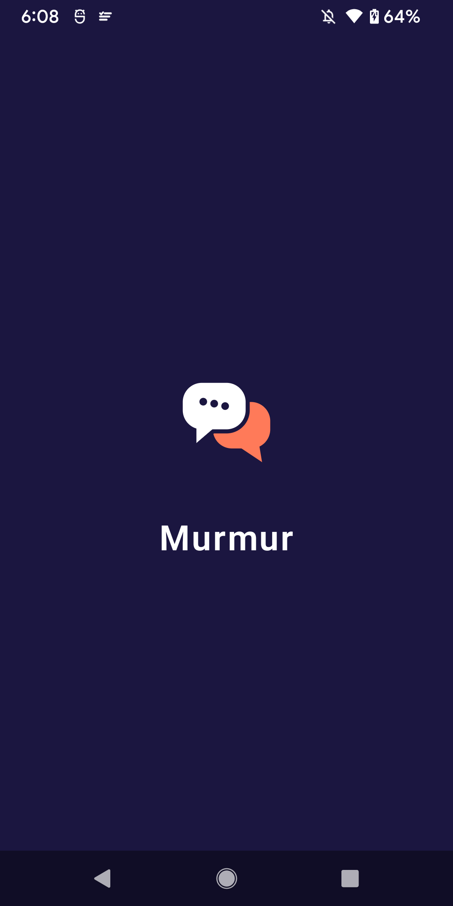 | 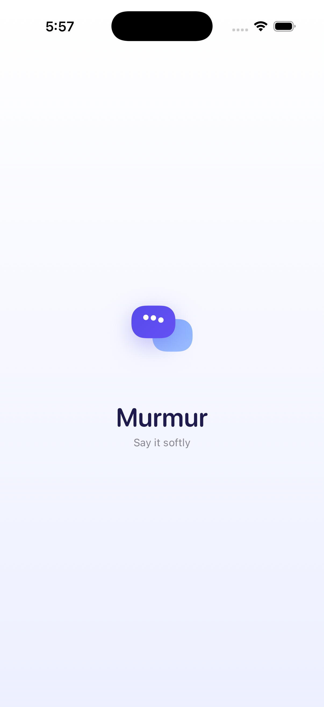 |
| Log in | 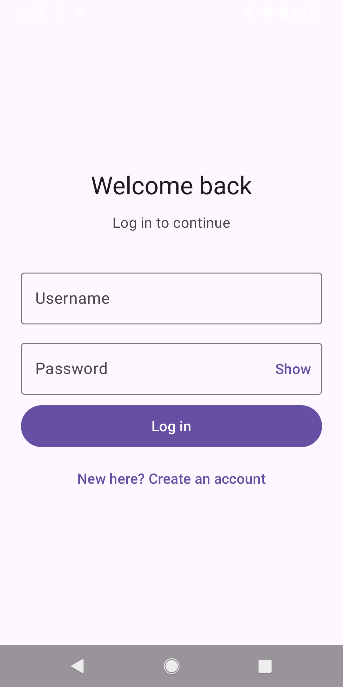  | 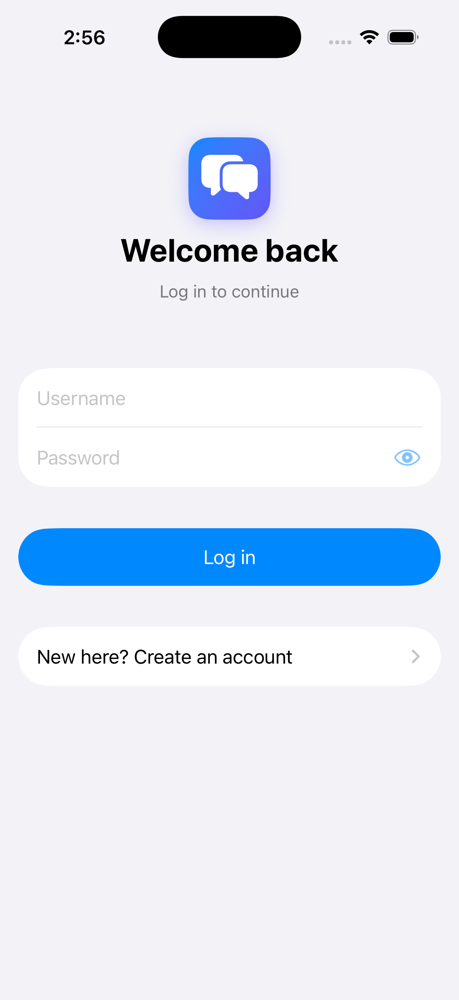  |
| Log in | 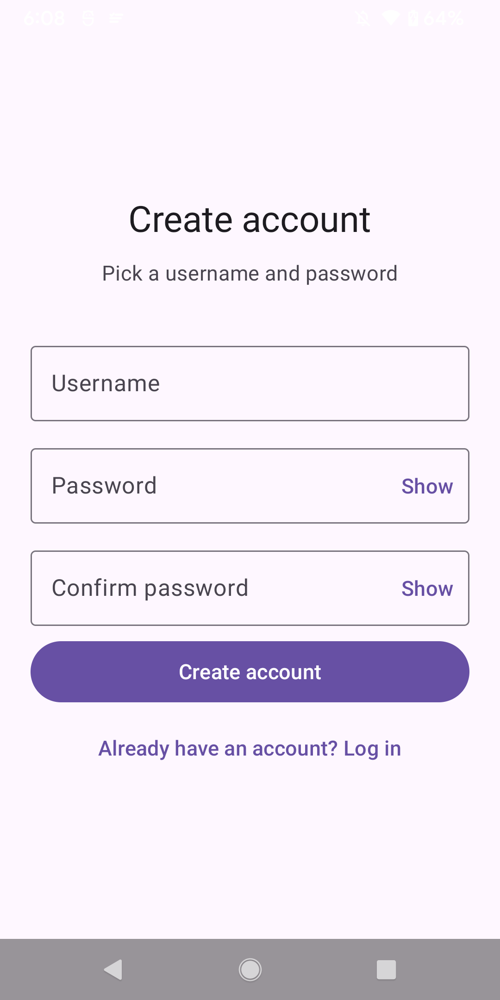  | 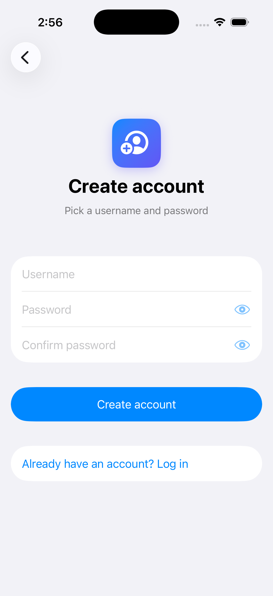  |
| Chats | 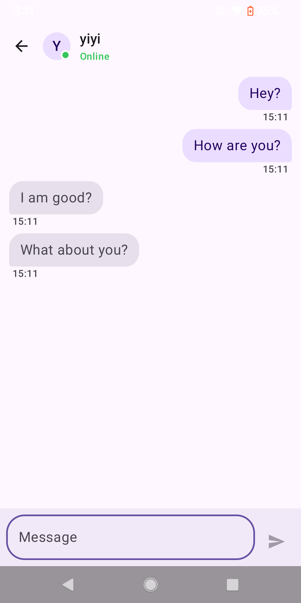   | 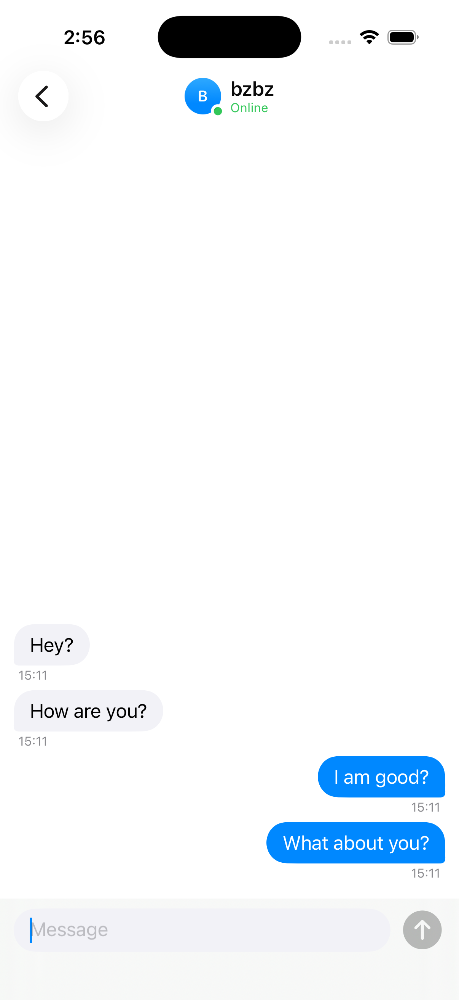   |
| Contact | 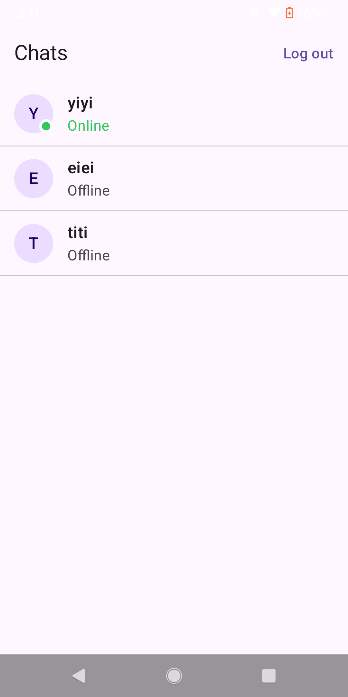 | 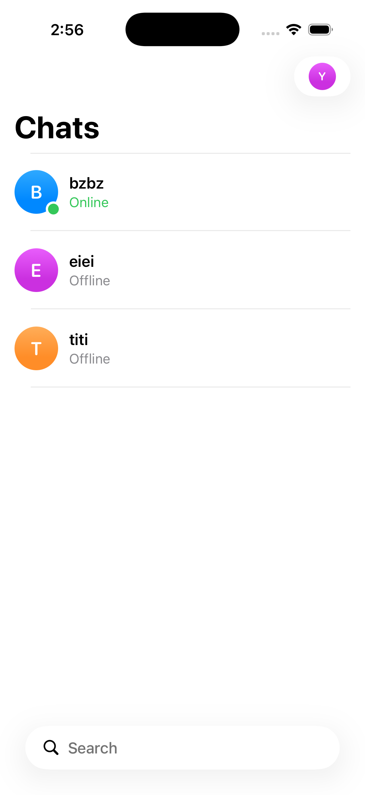 |

---

## Setup

### Requirements

- JDK 17 or newer
- Android Studio (current stable)
- Xcode (current stable) on a Mac, for iOS

### 1. Run the server

```bash
./gradlew :server:run
```

It listens on `http://localhost:<PORT>`. Set the port in your server config.

### 2. Run Android

1. Set the server URL in the app config. The emulator reaches your computer at `http://10.0.2.2:<PORT>`.
2. Open the project in Android Studio and run the `androidApp` configuration.

### 3. Run iOS

1. Set `AppConfig.baseURL` to the server URL (`http://localhost:<PORT>` for the simulator, your computer's LAN address for a device).
2. Open `iosApp` in Xcode and run. Xcode builds the shared framework through the Gradle build phase.

During development over plain HTTP you need `usesCleartextTraffic` on Android and an App Transport Security
exception on iOS.

### 4. Try it

Register two accounts (for example on an emulator and a simulator), log in on both, and send messages. Turn the
network off on one side to see a message fail and be retried.

### Tests
To test server run this on your browser `http://localhost:<PORT>/`, it should show "chat server is running" text

---

## Project Structure

```
.
├── core/            wire types: DTOs, events, validators
├── shared/
│   └── src/commonMain/kotlin/com/example/chatappkross/
│       ├── auth/            auth domain + data
│       ├── chat/
│       │   ├── domain/      models, repository interfaces, TimeLabels
│       │   └── data/        Ktor data sources, RealtimeClient, ChatClient
│       ├── presentation/    shared view models
│       ├── SessionManager.kt
│       └── SharedContainer.kt
├── server/          Ktor server
├── androidApp/      Compose UI + Android wrappers
├── iosApp/          SwiftUI UI + iOS wrappers
```

---

This is a Kotlin Multiplatform project targeting Android, iOS, Server.

* [/app/iosApp](./app/iosApp/iosApp) contains an iOS application. Even if you’re sharing your UI with Compose Multiplatform,
  you need this entry point for your iOS app. This is also where you should add SwiftUI code for your project.

* [/app/sharedLogic](./app/sharedLogic/src) is for the code that will be shared between app targets in the project.
  The most important subfolder is [commonMain](./app/sharedLogic/src/commonMain/kotlin). If preferred, you
  can add code to the platform-specific folders here too.

* [/app/sharedUI](./app/sharedUI/src) is for code that will be shared across your Compose Multiplatform applications.
  It contains several subfolders:
  - [commonMain](./app/sharedUI/src/commonMain/kotlin) is for code that’s common for all targets.
  - Other folders are for Kotlin code that will be compiled for only the platform indicated in the folder name.
    For example, if you want to use Apple’s CoreCrypto for the iOS part of your Kotlin app,
    the [iosMain](./app/sharedUI/src/iosMain/kotlin) folder would be the right place for such calls.
    Similarly, if you want to edit the Desktop (JVM) specific part, the [jvmMain](./app/sharedUI/src/jvmMain/kotlin)
    folder is the appropriate location.

* [/core](./core/src) is for the code that will be shared between all targets in the project.
  The most important subfolder is [commonMain](./core/src/commonMain/kotlin). If preferred, you
  can add code to the platform-specific folders here too.

* [/server](./server/src/main/kotlin) is for the Ktor server application.

### Running the apps

Use the run configurations provided by the run widget in your IDE's toolbar. You can also use these commands and options:

- Android app: `./gradlew :app:androidApp:assembleDebug`
- Server: `./gradlew :server:run`
- iOS app: open the [/app/iosApp](./app/iosApp) directory in Xcode and run it from there.

---

Learn more about [Kotlin Multiplatform](https://www.jetbrains.com/help/kotlin-multiplatform-dev/get-started.html)…
